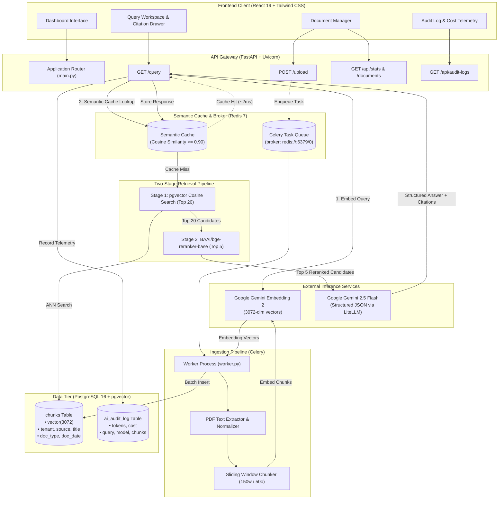
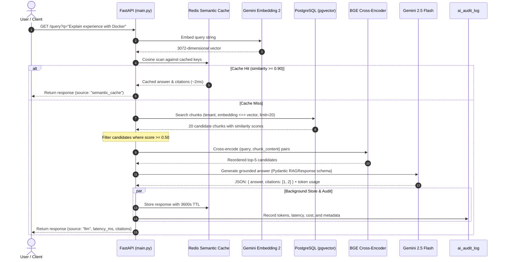

# Nexus RAG: Two-Stage Hybrid Retrieval Engine

[](https://fastapi.tiangolo.com)
[](https://react.dev/)
[](https://github.com/pgvector/pgvector)
[](https://redis.io)
[](https://docs.celeryq.dev)
[](https://ai.google.dev/)
[](https://tailwindcss.com/)
[](LICENSE)

A modular Retrieval-Augmented Generation (RAG) service designed for low-latency question answering, structured citation tracking, and operational observability. Built with FastAPI, PostgreSQL/pgvector, Redis semantic caching, Celery asynchronous ingestion, cross-encoder neural reranking, and a React 19 administrative interface.

---

## Table of Contents

- [Core Architecture](#core-architecture)
- [Key Features](#key-features)
- [System Workflow](#system-workflow)
- [Technology Stack](#technology-stack)
- [Project Layout](#project-layout)
- [Quick Start](#quick-start)
- [Evaluation & Testing](#evaluation--testing)
- [API Reference](#api-reference)
- [Operational Commands](#operational-commands)
- [Production Roadmap](#production-roadmap)
- [License](#license)

---

## Core Architecture



---

## Key Features

- **Two-Stage Vector Retrieval & Reranking**:
  - **Stage 1 (Bi-Encoder ANN)**: Candidate retrieval using PostgreSQL `pgvector` with Cosine Distance (`<=>`) over 3072-dimensional embeddings, filtered at `similarity >= 0.50`.
  - **Stage 2 (Cross-Encoder Reranker)**: Deep joint token attention using `BAAI/bge-reranker-base` to eliminate false positives and promote the most contextually relevant passages to top-$K$. Includes automatic GPU VRAM detection and CPU fallback.
- **Sub-10ms Redis Semantic Caching**:
  - Compares query embedding vectors against cached query keys in Redis using cosine similarity (`CACHE_THRESHOLD = 0.90`, 1-hour TTL).
  - Semantically identical or repeated queries return in approximately 2ms without invoking external LLM APIs.
- **Asynchronous Document Ingestion**:
  - Document uploads offload parsing, sanitization, sliding-window chunking (150 words with 50-word overlap), and embedding generation to Celery background workers.
- **Schema-Enforced Grounded Answers & Citations**:
  - LLM completion uses Gemini 2.5 Flash via LiteLLM with strict Pydantic JSON validation (`RAGResponse`).
  - Output is constrained to provided passages, and each claim must reference the 1-based index of the supporting chunk.
- **Observability and Cost Tracking**:
  - Non-cached queries log input tokens, output tokens, candidate counts, latency, and estimated cost into a persistent `ai_audit_log` PostgreSQL table.
- **Single-Page Administrative Dashboard**:
  - Pre-built React 19 interface with real-time cluster health monitors, interactive citation inspection, knowledge base controls, and token usage history.
- **Multi-Tenant Scoping**:
  - Database schema and retrieval filters enforce tenant separation at the query layer.

---

## System Workflow



---

## Technology Stack

| Layer | Component | Specification | Description |
| :--- | :--- | :--- | :--- |
| **Generation** | Gemini 2.5 Flash | `gemini/gemini-2.5-flash` via LiteLLM | Structured Pydantic generation with citation enforcement |
| **Embeddings** | Gemini Embedding 2 | `gemini-embedding-2` | 3072-dimensional vector representation |
| **Reranking** | Cross-Encoder | `BAAI/bge-reranker-base` | Neural pair scoring with automatic GPU/CPU fallback |
| **Database** | PostgreSQL 16 | `pgvector/pgvector:pg16` | Relational metadata storage and HNSW vector index |
| **Cache & Queue** | Redis 7 | `redis:7` | Semantic vector caching and Celery message broker |
| **Worker Engine** | Celery | Celery 5.x | Background asynchronous PDF extraction and chunking |
| **Backend API** | FastAPI | Python 3.11+, Pydantic v2 | High-throughput async REST endpoints |
| **Frontend UI** | React 19 | Vite, Tailwind CSS v4, Lucide | Operational dashboard and telemetry inspection |

---

## Project Layout

```text
├── docker-compose.yml          # Container configuration for PostgreSQL (pgvector) and Redis
├── requirements.txt            # Python dependencies
├── .env.example                # Configuration template for API keys and connection URLs
├── main.py                     # FastAPI application entrypoint and route handlers
├── rag.py                      # Embedding logic, text chunking, and LLM prompt assembly
├── reranker.py                 # Cross-encoder reranker with VRAM probe and CPU fallback
├── db.py                       # PostgreSQL schema definitions, vector search, and audit logs
├── cache.py                    # Redis semantic cache implementation with cosine similarity
├── worker.py                   # Celery background tasks for document parsing and indexing
├── models.py                   # Pydantic models (Citations, RAGResponse)
├── validate_dataset.py         # Phase 5A: Evaluation dataset and database schema validator
├── evaluate_retrieval.py       # Phase 5B: pgvector Recall@K, MRR, and MAP evaluator
├── evaluate_reranker.py        # Phase 5C: Cross-encoder ranking improvement evaluator
├── evaluate_answers.py         # Phase 5D: Citation provenance and answer overlap evaluator
├── evaluate_performance.py     # Phase 5E: Component latency telemetry and cache hit testing
├── run_evaluation.py           # Master runner compiling evaluation_results/summary.md
├── eval.json                   # Ground-truth evaluation dataset
├── tests/                      # Automated unit and regression test suite
│   ├── test_evaluation_metrics.py  # Deterministic metric unit tests (Recall, MRR, MAP, F1)
│   └── test_rag_regression.py      # Pipeline regression tests (chunking, isolation, audit)
├── evaluation_results/         # Generated evaluation reports and JSON benchmark data
│   ├── summary.md              # Markdown evaluation report
│   ├── retrieval_results.json  # Raw and filtered retrieval metrics
│   ├── reranker_results.json   # Comparative reranker performance
│   ├── answer_results.json     # Grounded answer and citation validity metrics
│   └── performance_results.json# Component latency percentiles and cache metrics
├── frontend/                   # React 19 administrative SPA
│   ├── package.json
│   ├── vite.config.js
│   ├── dist/                   # Static compiled assets served by FastAPI
│   └── src/
│       ├── App.jsx
│       └── components/
└── temp/                       # Working directory for document uploads
```

---

## Quick Start

### 1. Prerequisites

- Docker and Docker Compose
- Python 3.10 or higher
- Node.js 18 or higher (optional, only required to modify or rebuild the frontend)
- Google Gemini API key

### 2. Environment Configuration

```bash
git clone https://github.com/your-username/nexus-rag.git
cd nexus-rag

cp .env.example .env
```

Set your Gemini API key in `.env`:

```ini
GEMINI_API_KEY=your_gemini_api_key_here
```

### 3. Start Database and Cache Containers

```bash
docker compose up -d
docker compose ps
```

PostgreSQL is available on port `5432` and Redis on port `6379`.

### 4. Set Up Python Environment

```bash
python3 -m venv venv
source venv/bin/activate
pip install -r requirements.txt
```

### 5. Start the Background Ingestion Worker

In a dedicated terminal:

```bash
source venv/bin/activate
celery -A worker.celery worker --loglevel=info
```

### 6. Start the API Server

In another terminal:

```bash
source venv/bin/activate
uvicorn main:app --reload --port 8000
```

- Administrative Dashboard: [http://localhost:8000](http://localhost:8000)
- OpenAPI Documentation: [http://localhost:8000/docs](http://localhost:8000/docs)
- ReDoc Documentation: [http://localhost:8000/redoc](http://localhost:8000/redoc)

---

## Evaluation & Testing

The project includes an end-to-end evaluation suite that verifies data integrity, vector retrieval, cross-encoder reranking, answer quality, citation validity, component latency, and regression safety.

### Running Automated Unit & Regression Tests

```bash
source venv/bin/activate
export HF_HUB_OFFLINE=1

python -m unittest discover tests
```

### Running Individual Evaluation Stages

```bash
# Phase 5A: Validate evaluation dataset against PostgreSQL chunks
python validate_dataset.py

# Phase 5B: Evaluate vector retrieval (Recall@5, Recall@10, Recall@20, MRR, MAP)
python evaluate_retrieval.py

# Phase 5C: Evaluate cross-encoder reranker impact on identical candidates
python evaluate_reranker.py

# Phase 5D: Evaluate live generation, citation validity, and token overlap
python evaluate_answers.py

# Phase 5E: Measure component-level latency and semantic cache behavior
python evaluate_performance.py

# Orchestrate all phases and compile evaluation_results/summary.md
python run_evaluation.py
```

### Measured Evaluation Highlights

- **Reranker MAP Gain**: Neural reranking improved Mean Average Precision from **0.8639 to 0.9867 (+14.2% relative gain)**, successfully elevating relevant project passages over generic headers.
- **Citation Provenance**: **100% (10/10)** of generated responses included valid citations referencing existing database chunks with matching source metadata.
- **Semantic Cache Efficiency**: Average cache hit latency was **2.54 ms**, representing a **~1260x reduction** in query latency compared to uncached execution (~3.2 seconds).

Full reports and metrics are stored in [`evaluation_results/summary.md`](./evaluation_results/summary.md).

---

## API Reference

### Ingest Document

Uploads a PDF document and queues it for asynchronous parsing, chunking, and embedding.

- **URL**: `POST /upload`
- **Content-Type**: `multipart/form-data`
- **Body**: `file=@document.pdf`
- **Response**:

```json
{
  "status": "indexing",
  "filename": "document.pdf",
  "path": "temp/document.pdf"
}
```

### Execute RAG Query

Processes a user query through the two-stage retrieval and generation pipeline.

- **URL**: `GET /query?q={query_text}`
- **Response (Uncached - Generated by LLM)**:

```json
{
  "source": "llm",
  "latency_ms": 1420,
  "answer": "The system utilizes FastAPI, Celery, Redis, PostgreSQL, pgvector, and Gemini.",
  "citations": [
    {
      "chunk": 1,
      "source": "temp/document.pdf",
      "title": "temp/document.pdf",
      "content": "Built an async ticket pipeline (FastAPI + Celery + Redis)...",
      "score": 0.9982
    }
  ],
  "tokens": {
    "input": 512,
    "output": 84,
    "cost": 0.00018
  },
  "candidate_chunks_count": 5
}
```

- **Response (Cached - Retrieved from Redis)**:

```json
{
  "source": "semantic_cache",
  "latency_ms": 2,
  "answer": "The system utilizes FastAPI, Celery, Redis, PostgreSQL, pgvector, and Gemini.",
  "citations": [...]
}
```

### Cluster Telemetry

Returns database connectivity and chunk statistics.

- **URL**: `GET /api/stats`
- **Response**:

```json
{
  "postgres": {
    "status": "online",
    "chunks_count": 5,
    "documents_count": 1
  },
  "redis": {
    "status": "online",
    "cached_entries": 3
  },
  "models": {
    "llm": "gemini-2.5-flash",
    "embedding": "gemini-embedding-2 (3072 dims)",
    "reranker": "BAAI/bge-reranker-base"
  }
}
```

### Document Management

- `GET /api/documents`: List indexed documents and per-document chunk counts.
- `POST /api/flush-chunks`: Remove chunks for a specific document, or flush all chunks when no body is provided.
- `POST /api/flush-cache`: Evict semantic cache keys from Redis without affecting Celery queues.
- `GET /api/audit-logs?limit=15`: Return recent audit records including tokens, latency, and cost.

---

## Operational Commands

Inspect chunk count:
```bash
docker exec -it rag-postgres-1 psql -U postgres -d rag -c "SELECT count(*) FROM chunks;"
```

Inspect audit records:
```bash
docker exec -it rag-postgres-1 psql -U postgres -d rag -c "SELECT id, query, input_tokens, output_tokens, cost, created_at FROM ai_audit_log ORDER BY created_at DESC LIMIT 5;"
```

List cached query keys:
```bash
docker exec -it rag-redis-1 redis-cli --scan --pattern "semantic_cache:*"
```

---

## Production Roadmap

- [ ] **Hybrid Search (BM25 + Dense Vectors)**: Integrate PostgreSQL full-text search with pgvector embeddings using Reciprocal Rank Fusion (RRF) for enhanced keyword matching.
- [ ] **Streaming Responses (SSE)**: Add Server-Sent Events to stream tokens to the UI with citation placeholders.
- [ ] **Role-Based Access Control**: Add JWT authentication with role-based document access controls and tenant key scoping.
- [ ] **Multi-Format Ingestion**: Expand Celery ingestion to support DOCX, Markdown, HTML, and audio/video transcription.
- [ ] **Distributed Tracing & Metrics**: Export OpenTelemetry traces and Prometheus metrics for p95 and p99 vector search latencies.

---

## License

This project is licensed under the [MIT License](LICENSE).
