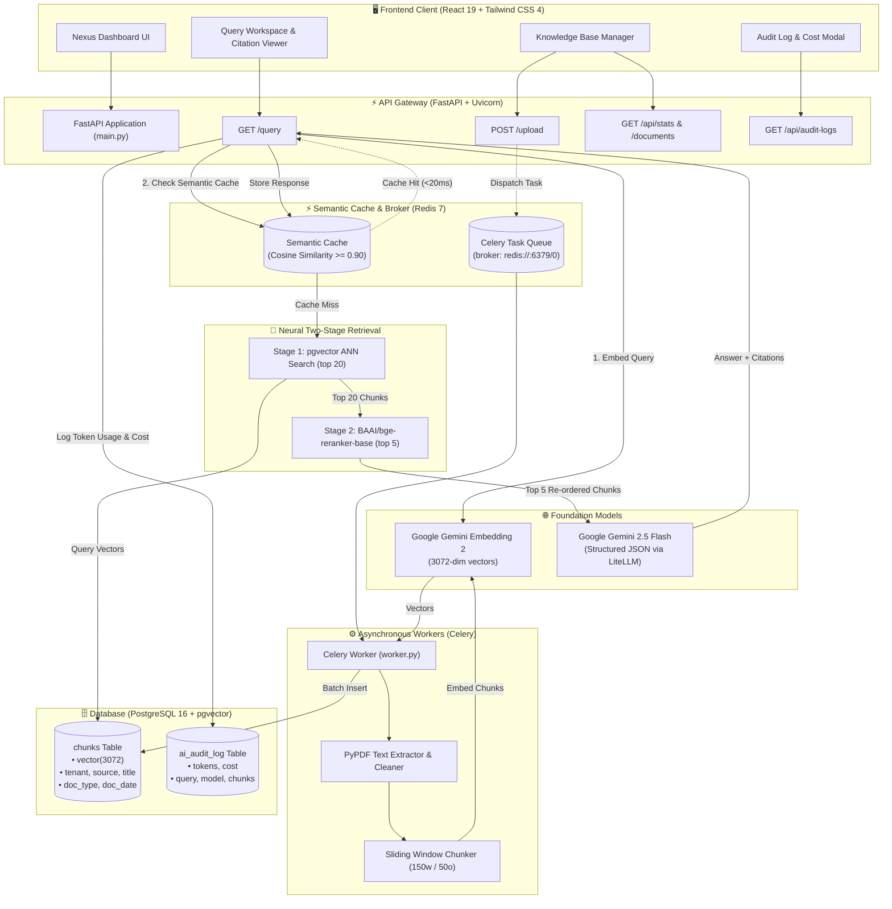
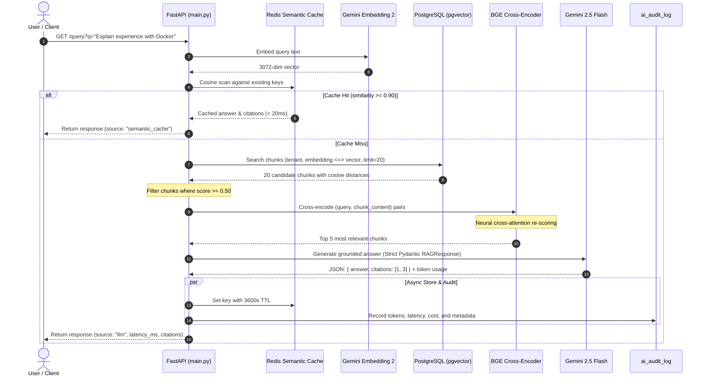

# ⚡ Nexus RAG: Production-Ready Hybrid RAG Engine

<div align="center">

[](https://fastapi.tiangolo.com)
[](https://react.dev/)
[](https://github.com/pgvector/pgvector)
[](https://redis.io)
[](https://docs.celeryq.dev)
[](https://ai.google.dev/)
[](https://tailwindcss.com/)
[](LICENSE)

<p align="center">
  <strong>An enterprise-grade, high-performance Retrieval-Augmented Generation (RAG) platform featuring asynchronous distributed ingestion, two-stage vector retrieval with neural cross-encoder reranking, Redis cosine semantic caching, token audit logging, and a sleek React 19 operational cockpit.</strong>
</p>

[Key Features](#-key-features) • [System Architecture](#-system-architecture) • [Two-Stage Retrieval](#-two-stage-retrieval-pipeline) • [Tech Stack](#-tech-stack) • [Quick Start](#-quick-start) • [API Reference](#-api-reference) • [Production Roadmap](#-production-hardening-roadmap)

</div>

---

## 🌟 Key Features

- **⚡ Sub-Second Redis Semantic Caching**:
  - Computes cosine similarity across query vector embeddings in Redis (`CACHE_THRESHOLD = 0.90`, 1-hour TTL).
  - Repeated or semantically identical questions hit cache in **under 20ms**, cutting LLM inference costs and rate-limit consumption to zero.
- **🧠 Two-Stage Precision Retrieval & Reranking**:
  - **Stage 1 (Bi-Encoder ANN)**: Fast candidate retrieval using `pgvector` Cosine Distance (`<=>`) over high-dimensional **3072-dim** embeddings with pre-filtering (`similarity >= 0.50`).
  - **Stage 2 (Cross-Encoder Reranker)**: Deep semantic re-scoring using `BAAI/bge-reranker-base` (PyTorch with FP16 GPU/CPU acceleration) to eliminate false positives and position the most critical passages at top-$K$.
- **📄 Asynchronous Distributed Ingestion Pipeline**:
  - Document uploads return instantly via non-blocking **Celery** background tasks backed by **Redis**.
  - Handles PDF parsing (`pypdf`), text sanitization, sliding-window chunking (150 words with 50-word overlap), and batch vectorization using Google's `gemini-embedding-2`.
- **🎯 Grounded Answer Generation & Citation Enforcement**:
  - Leverages **Gemini 2.5 Flash** via LiteLLM with strict **Pydantic schema validation** (`RAGResponse`).
  - Zero-hallucination system prompt restricts answers exclusively to supplied contexts and links every claim directly to indexed source chunk IDs.
- **📊 Observability & Cost Auditing**:
  - Every non-cached LLM invocation automatically logs query text, model, input/output tokens, candidate chunks count, and dollar cost into an immutable `ai_audit_log` PostgreSQL table.
- **💻 Modern React 19 + Tailwind CSS 4 UI**:
  - Single-Page Application (SPA) with a sleek dark aesthetic, real-time cluster health indicators (PostgreSQL and Redis live status), interactive citation inspection drawer, document deletion/flush controls, and query telemetry.
- **🏢 Multi-Tenant Architecture**:
  - Database schema and retrieval filters are architected natively around tenant isolation (`tenant` keys).

---

## 🏗️ System Architecture



---

## 🔄 Two-Stage Retrieval & Semantic Cache Flow



---

## 🛠️ Tech Stack & Model Specifications

| Component | Technology | Specification / Version | Purpose |
| :--- | :--- | :--- | :--- |
| **Generative LLM** | Google Gemini | `gemini-2.5-flash` via LiteLLM | Fast, cost-efficient, citation-grounded reasoning |
| **Embedding Model** | Google Gemini | `gemini-embedding-2` (3072 dims) | High-resolution semantic vector representation |
| **Neural Reranker** | Hugging Face / BAAI | `BAAI/bge-reranker-base` | Cross-encoder contextual reranking (FP16 GPU/CPU) |
| **Vector Store** | PostgreSQL 16 | `pgvector/pgvector:pg16` | ACID-compliant relational + vector similarity indexing |
| **Semantic Cache** | Redis | `redis:7` | Sub-20ms query caching with cosine similarity thresholding |
| **Task Queue** | Celery + Redis | Celery 5.x | Asynchronous, non-blocking document ingestion worker |
| **Backend Framework**| FastAPI | Python 3.11+, Uvicorn, Pydantic v2 | High-concurrency RESTful API endpoints |
| **Frontend Framework**| React 19 | Vite 8, Tailwind CSS v4, Lucide Icons | Responsive glassmorphism dashboard & telemetry |

---

## 📂 Project Structure

```
├── docker-compose.yml       # Infrastructure orchestration (Postgres pgvector:16 & Redis:7)
├── requirements.txt         # Python backend dependencies
├── .env.example             # Template for API keys and database configuration
├── main.py                  # FastAPI application entrypoint, REST routing & static mount
├── rag.py                   # Embedding generation, text chunking, and LiteLLM prompt engine
├── reranker.py              # BAAI/bge-reranker-base cross-encoder neural reranking
├── db.py                    # PostgreSQL schema definition, pgvector queries & audit logs
├── cache.py                 # Redis semantic caching logic (cosine similarity & TTL)
├── worker.py                # Celery asynchronous background tasks for PDF document indexing
├── models.py                # Pydantic schemas (Citations, RAGResponse)
├── useful_commands.txt      # Curated CLI snippets for DB operations, cache flushes & testing
├── temp/                    # Working directory for uploaded documents (.gitkeep preserved)
└── frontend/                # Production Single Page Application (SPA)
    ├── package.json         # React 19 & Tailwind CSS 4 build configuration
    ├── vite.config.js       # Vite build & frontend bundling configuration
    ├── index.html           # HTML entrypoint
    ├── dist/                # Pre-built static SPA assets (served by FastAPI at root)
    └── src/
        ├── App.jsx          # Root SPA component with telemetry loop & modal triggers
        ├── main.jsx         # React DOM mount point
        └── components/
            ├── Header.jsx           # Cluster status badges, stats refresher & navigation
            ├── QueryWorkspace.jsx   # Search bar, LLM citation cards, latency & token stats
            ├── KnowledgeBase.jsx    # PDF dropzone, chunk counts, document delete & flushes
            └── AuditLogModal.jsx    # Real-time token usage, cost calculator & query history
```

---

## 🚀 Quick Start

### 1. Prerequisites
- [Docker](https://docs.docker.com/get-docker/) & [Docker Compose](https://docs.docker.com/compose/)
- [Python 3.10+](https://www.python.org/)
- [Node.js 18+](https://nodejs.org/) (for frontend customization or building)
- A [Google Gemini API Key](https://aistudio.google.com/app/apikey)

---

### 2. Clone & Environment Configuration

```bash
git clone https://github.com/your-username/nexus-rag.git
cd nexus-rag

# Create your .env file
cp .env.example .env
```

Edit `.env` and supply your Gemini API key:
```ini
GEMINI_API_KEY=AIzaSy...your_gemini_api_key_here
```

---

### 3. Launch Infrastructure (Docker)

Spin up PostgreSQL (with pgvector extension) and Redis:

```bash
docker compose up -d
```

Verify that both containers are running healthy:
```bash
docker compose ps
```
> PostgreSQL is exposed on `localhost:5432` and Redis on `localhost:6379`.

---

### 4. Setup Python Virtual Environment

```bash
# Create and activate virtual environment
python3 -m venv venv
source venv/bin/activate

# Install backend dependencies
pip install --upgrade pip
pip install -r requirements.txt
```

---

### 5. Launch the Celery Ingestion Worker

In a dedicated terminal tab with your virtual environment active:

```bash
source venv/bin/activate
celery -A worker.celery worker --loglevel=info
```

---

### 6. Launch the FastAPI Server

In another terminal tab:

```bash
source venv/bin/activate
uvicorn main:app --reload --port 8000
```

---

### 7. Access the Application

- **Web Dashboard**: Navigate to [http://localhost:8000](http://localhost:8000)
- **Interactive Swagger API Docs**: Navigate to [http://localhost:8000/docs](http://localhost:8000/docs)
- **Alternative ReDoc**: Navigate to [http://localhost:8000/redoc](http://localhost:8000/redoc)

*(Optional) If you want to develop or modify the frontend with instant hot-reloading:*
```bash
cd frontend
npm install
npm run dev
```

*(To re-compile the frontend production bundle):*
```bash
cd frontend
npm run build
```

---

## 📡 API Reference

### 1. Ingest Document
Uploads a PDF document and queues background extraction, chunking, and embedding.
- **Endpoint**: `POST /upload`
- **Payload**: `multipart/form-data` with `file=@document.pdf`
- **Response**:
```json
{
  "status": "indexing",
  "filename": "My_Resume.pdf",
  "path": "temp/My_Resume.pdf"
}
```

### 2. Execute RAG Query
Queries the system using two-stage retrieval with semantic cache bypass.
- **Endpoint**: `GET /query?q={query_string}`
- **Response (Cache Miss - LLM Generation)**:
```json
{
  "source": "llm",
  "latency_ms": 1420,
  "answer": "Shardul has extensive experience in distributed systems, PyTorch, and vector databases.",
  "citations": [
    {
      "chunk": 1,
      "source": "temp/My_Resume.pdf",
      "title": "temp/My_Resume.pdf",
      "content": "Engineered multi-tenant RAG systems using pgvector and Celery...",
      "score": 0.8924
    }
  ],
  "tokens": {
    "input": 512,
    "output": 84,
    "cost": 0.00018
  },
  "candidate_chunks_count": 5
}
```
- **Response (Cache Hit - Instant Retrieval)**:
```json
{
  "source": "semantic_cache",
  "latency_ms": 18,
  "answer": "Shardul has extensive experience in distributed systems, PyTorch, and vector databases.",
  "citations": [...]
}
```

### 3. Cluster Telemetry
- **Endpoint**: `GET /api/stats`
- **Response**:
```json
{
  "postgres": {
    "status": "online",
    "chunks_count": 48,
    "documents_count": 3
  },
  "redis": {
    "status": "online",
    "cached_entries": 4
  },
  "models": {
    "llm": "gemini-2.5-flash",
    "embedding": "gemini-embedding-2 (3072 dims)",
    "reranker": "BAAI/bge-reranker-base"
  }
}
```

### 4. Knowledge Base Operations
- `GET /api/documents`: List indexed documents and chunk statistics.
- `POST /api/flush-chunks`: Delete chunks for a specific document or flush all vectors.
  ```json
  // Delete single document
  { "source": "temp/My_Resume.pdf" }
  // Truncate all chunks
  {}
  ```
- `POST /api/flush-cache`: Evict all cached queries from Redis without disrupting Celery queues.
- `GET /api/audit-logs?limit=15`: Retrieve recent audit records including token usage and costs.

---

## 🧪 Testing with cURL

Upload a document:
```bash
curl -X POST "http://127.0.0.1:8000/upload" \
  -F "file=@/path/to/your/document.pdf"
```

Submit a query:
```bash
curl -G "http://127.0.0.1:8000/query" \
  --data-urlencode "q=What are the primary qualifications listed?"
```

Check audit log:
```bash
curl "http://127.0.0.1:8000/api/audit-logs?limit=5"
```

---

## 🛠️ Helpful Operational Commands

Refer to [`useful_commands.txt`](./useful_commands.txt) for a complete list of debugging and administration snippets:

```bash
# Inspect total chunk count in PostgreSQL
docker exec -it rag-postgres-1 psql -U postgres -d rag -c "SELECT count(*) FROM chunks;"

# Inspect audit log entries
docker exec -it rag-postgres-1 psql -U postgres -d rag -c "SELECT id, query, input_tokens, output_tokens, cost, created_at FROM ai_audit_log ORDER BY created_at DESC LIMIT 5;"

# Flush semantic cache from Redis CLI
docker exec -it rag-redis-1 redis-cli --scan --pattern "semantic_cache:*" | xargs -r docker exec -i rag-redis-1 redis-cli del
```

---

## 🔮 Production Hardening Roadmap

While Nexus RAG contains a complete core engine, the following enhancements are planned for enterprise scale:

- [ ] **Hybrid Search (BM25 + Dense Vectors)**: Integrate Reciprocal Rank Fusion (RRF) combining PostgreSQL `pg_trgm` / full-text search with pgvector embeddings for enhanced keyword and code recall.
- [ ] **Streaming Responses (SSE)**: Implement Server-Sent Events (`StreamingResponse`) for token-by-token streaming in the UI with citation placeholders.
- [ ] **Auth & RBAC**: Add JWT / OAuth2 authentication with role-based document access control and tenant key scoping.
- [ ] **Multi-Format Ingestion**: Expand Celery ingestion pipeline to support `.docx`, `.pptx`, Markdown, HTML, and audio/video transcription.
- [ ] **Automated Evaluation Suite**: Integrate continuous automated RAG evaluation using [Ragas](https://github.com/explodinggradients/ragas) or TruLens (Faithfulness, Answer Relevance, Context Recall).
- [ ] **Distributed Tracing & Metrics**: Export OpenTelemetry traces and Prometheus metrics for vector search latency percentiles (p95, p99).

---

## 📄 License

This project is licensed under the [MIT License](LICENSE). Contributions, issues, and feature suggestions are welcome!
